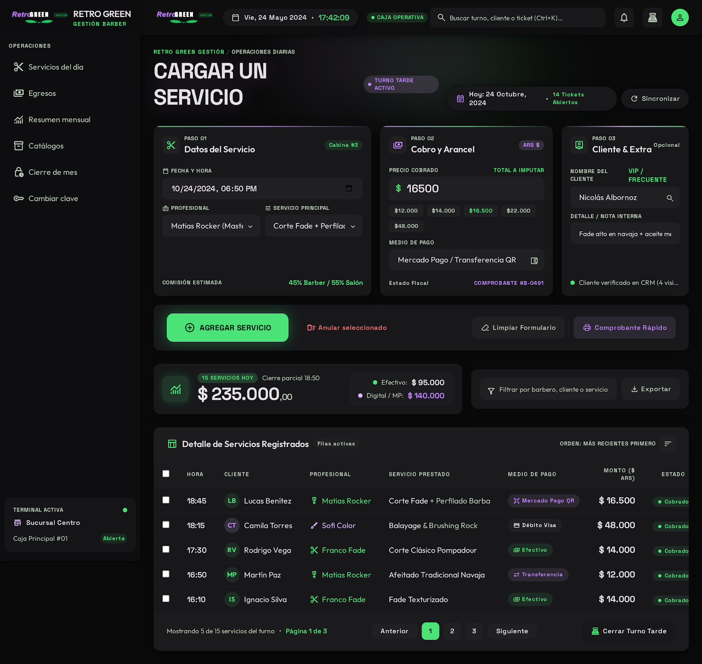

# Retro Green Gestión 💈

Aplicación de escritorio para la **gestión económica de una barbería / peluquería**.
Reemplaza la planilla de cálculo por un programa propio: rápido, sin fórmulas que se
rompan, con los datos **cifrados** en la misma computadora y pensado para que lo use
gente que no es técnica.



---

## ✨ Qué hace

- **Servicios del día** — cargás cada servicio (profesional, servicio, precio, medio de
  pago, cliente y nota). El precio sugerido se completa solo al elegir el servicio.
  Podés ver los registros por **día, semana o mes**.
- **Egresos** — gastos por categoría, con su medio de pago.
- **Clientes** — un buscador con lupa (en vivo, sin importar acentos ni mayúsculas) para
  encontrar a los clientes atendidos y ver su **historial** y sus **preferencias**
  (servicio y profesional habitual, notas).
- **Asistente** — un bot *offline* que responde preguntas sobre los datos y muestra
  gráficos: *"¿cuántos cortes hoy?"*, *"¿cuánto facturé este mes?"*, *"¿quién hizo más?"*,
  *"¿qué hizo Martín?"*, etc. No usa internet: los datos nunca salen de la máquina.
- **Resumen mensual (dashboard)** — ingresos, egresos, neto, servicios, ganancia semanal,
  servicio más vendido, rendimiento por profesional (con su % del total), medios de pago,
  gastos por categoría e histórico de meses cerrados.
- **Exportación a Excel** — genera el `.xlsx` del mes para el contador (resumen, libro
  diario, egresos e histórico). No necesita tener Office instalado.
- **Cierre de mes** — guarda el resumen del mes (sobrevive aunque se purgue el detalle) y
  avisa si hay meses sin exportar.
- **Catálogos** — servicios, profesionales, medios de pago y categorías de gasto.
- **Copias de seguridad** automáticas de la base (con su llavero).

## 🔐 Seguridad

- La base de datos se guarda **cifrada con SQLCipher**. Si alguien copia el archivo a un
  pendrive, no lo puede abrir con nada.
- **Usuarios con contraseña propia y roles.** El administrador (Ezequiel) crea y elimina
  usuarios y accede a la configuración; el resto solo opera el día a día.
- La base no se cifra con la contraseña directamente, sino con una **llave aleatoria**
  guardada en un "llavero" (`gestion.llave`), envuelta con la contraseña de cada usuario.
  Esto permite **cambiar o recuperar la contraseña** sin romper el cifrado.
- **Códigos de recuperación** de un solo uso para recuperar el acceso si se olvida la clave.
- **Contraseña de emergencia** (opcional): al escribirla en el login, borra la base al
  instante (borrado criptográfico), para destruir los datos bajo coacción.

## 🛠️ Tecnología

- **C# / .NET 9** — WinForms (escritorio Windows).
- **SQLite + SQLCipher** (`Microsoft.Data.Sqlite.Core` + `SQLitePCLRaw.bundle_e_sqlcipher`).
- **ClosedXML** para generar el Excel.
- Gráficos dibujados a mano con GDI+, sin librerías de terceros.

## 💻 Requisitos

- **Windows 10/11 (x64).**
- Para **usar la app**: nada. El ejecutable publicado es **autocontenido** (incluye .NET).
- Para **compilar el código**: [.NET 9 SDK](https://dotnet.microsoft.com/download).

## ▶️ Cómo ejecutar

### Opción A — ejecutable autocontenido (recomendado para el local)

```bash
dotnet publish RetroGreenGestion.csproj -c Release -r win-x64 --self-contained true -p:PublishSingleFile=true -p:IncludeNativeLibrariesForSelfExtract=true -p:EnableCompressionInSingleFile=true
```

Queda **un solo `.exe`** que se copia a la computadora y se abre con doble click. La
primera vez, Windows SmartScreen puede pedir *Más información → Ejecutar de todas formas*
(porque el `.exe` no está firmado).

### Opción B — desde el código

```bash
dotnet run --project RetroGreenGestion.csproj
```

La **primera vez** se crea el usuario administrador y la base de datos.

## 📁 Dónde se guardan los datos

En `Documentos\Retro Green` de cada computadora:

- `gestion.db` — la base cifrada.
- `gestion.llave` — el llavero (sin él, la base no se puede abrir).
- `Copias de seguridad\` — backups automáticos.

> El ejecutable y los datos son independientes: podés actualizar el `.exe` sin perder nada.
> Para **mudar los datos** a otra PC, copiá `gestion.db` **y** `gestion.llave` juntos.

## 🗂️ Estructura

```
RetroGreenGestion/
├── Program.cs              Punto de entrada
├── Datos/                  Acceso a datos y cifrado
│   ├── Bd.cs               Conexión, login, llavero, backups
│   ├── Llavero.cs          Cifrado de la llave (usuarios, recuperación, emergencia)
│   ├── Repo.cs             Consultas (servicios, egresos, clientes, resúmenes)
│   └── Esquema.cs          Esquema de la base
├── Ui/                     Pantallas (WinForms) y tema visual
├── Exportacion/            Generación del Excel (ClosedXML)
└── Assets/                 Logo (.png / .ico)
```

---

Hecho con cariño para **Retro Green – Barbería & Peluquería**.
